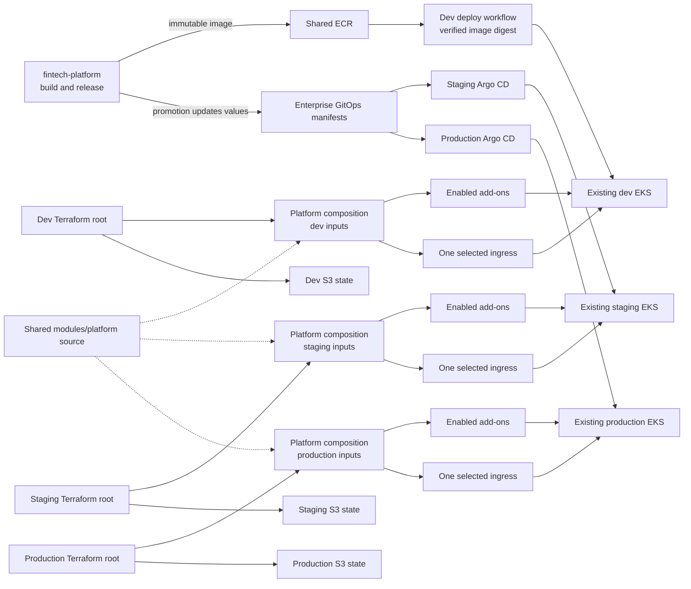

# Fintech platform infrastructure

This repository owns shared ECR infrastructure and Kubernetes platform
bootstrap for existing EKS clusters. Application source code is in
[`qzee-dev/fintech-platform`](https://github.com/qzee-dev/fintech-platform);
application Helm values and Argo CD ApplicationSets are in
[`qzee-dev/fintech-enterprise-gitops-manifest`](https://github.com/qzee-dev/fintech-enterprise-gitops-manifest).

## How the system works

Each environment root configures only its existing cluster. The roots reuse
Terraform module code, but each owns its own inputs and state. Child modules
do not create separate state files: their resources are tracked by the root
that calls them.

| Environment | Ingress default | Application deployment |
| --- | --- | --- |
| Dev | `f5-nginx` | Manually dispatched workflow deploys a verified image digest to an existing Deployment |
| Staging | `alb` | Staging Argo CD syncs the staging ApplicationSet |
| Production | `envoy` | Production Argo CD syncs the production ApplicationSet after approval |

## Repository map

- [`Ecr-Repo/`](Ecr-Repo/README.md): immutable ECR repositories and the source
  repository's image-publisher role.
- [`k8s/README.md`](k8s/README.md): Kubernetes module design, ingress choices,
  add-on dependencies, and state ownership.
- [`k8s/dev/README.md`](k8s/dev/README.md),
  [`k8s/staging/README.md`](k8s/staging/README.md), and
  [`k8s/production/README.md`](k8s/production/README.md): environment inputs
  and Terraform commands.
- `k8s/dev/terraform/ingress-dns01/`: a separate, optional dev ingress root;
  it is not part of the standard `modules/platform` deployment.
- [`RUNBOOK.md`](RUNBOOK.md): release integration, Terraform operations, and
  safe state/plan procedures.

## State and ownership

Dev, staging, and production use separate S3 backend keys. Always run
Terraform from the intended environment root and do not let multiple roots
manage the same cluster add-on or release. Existing dev local state must be
migrated to the dev S3 key as described in the [runbook](RUNBOOK.md). The
cluster, VPC, and worker nodes are owned by other infrastructure; this
repository bootstraps add-ons and ingress only.
