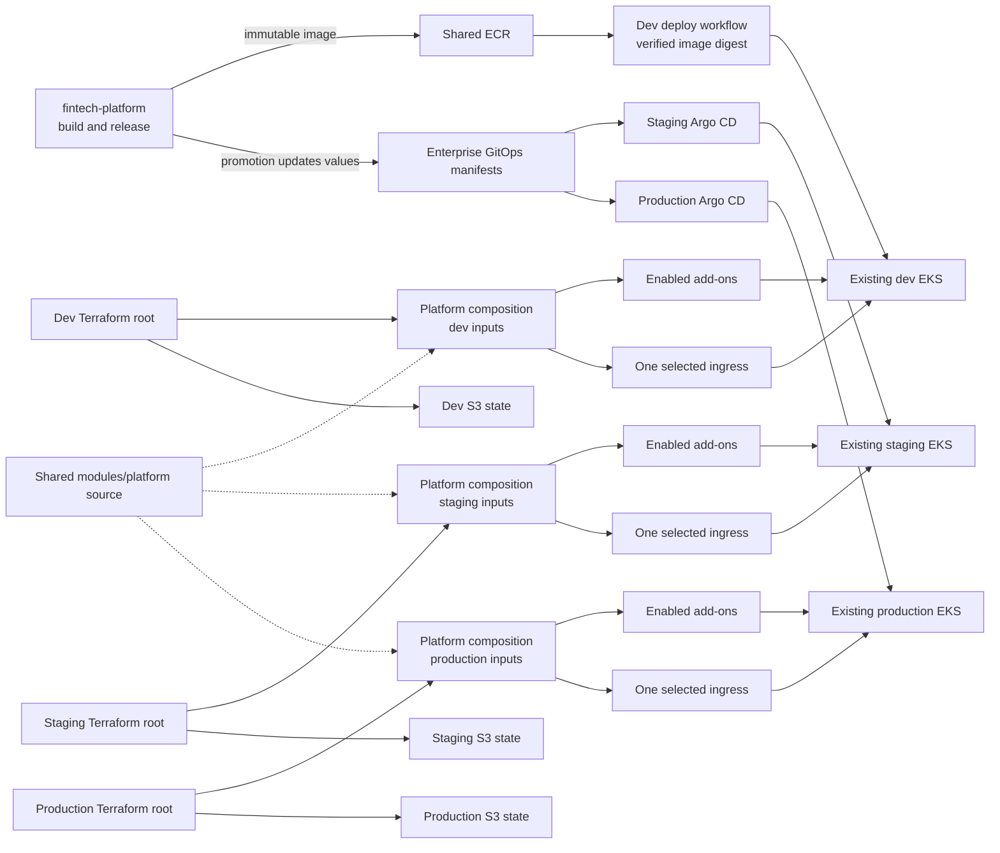
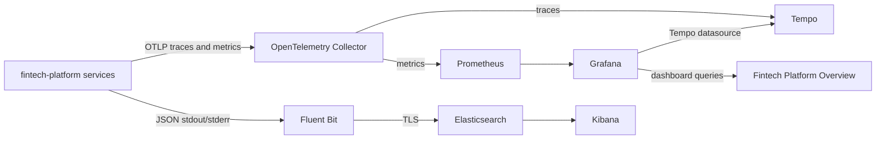
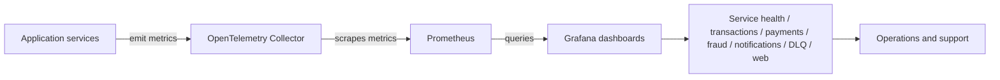

# Fintech platform infrastructure

This repository owns shared ECR infrastructure and Kubernetes platform
bootstrap for existing EKS clusters. Application source code is in
[`qzee-dev/fintech-platform`](https://github.com/qzee-dev/fintech-platform);
application Helm values and Argo CD ApplicationSets are in
[`qzee-dev/fintech-enterprise-gitops-manifest`](https://github.com/qzee-dev/fintech-enterprise-gitops-manifest).

## How the system works

Each environment root configures only its existing cluster. The roots reuse
Terraform module code, but each owns its own inputs and state. Child modules
do not create separate state files: their resources are tracked by the root
that calls them.

| Environment | Ingress default | Application deployment |
| --- | --- | --- |
| Dev | `f5-nginx` | Manually dispatched workflow deploys a verified image digest to an existing Deployment |
| Staging | `alb` | Staging Argo CD syncs the staging ApplicationSet |
| Production | `envoy` | Production Argo CD syncs the production ApplicationSet after approval |

## Observability and telemetry flow

This repo is the platform layer for the fintech stack. It provides the Kubernetes
and monitoring foundation, while the application repo emits the actual service
telemetry. The expected flow is:

The dashboard flow is:

The platform repo owns:

- Prometheus scraping and chart-provided alert rules
- Grafana with Prometheus and Tempo datasources
- OpenTelemetry Collector deployment
- Tempo deployment for trace storage
- Elasticsearch, Kibana, and Fluent Bit
- ingress and routing for Grafana, Prometheus, and Kibana

The application repo owns:

- service-level OpenTelemetry initialization
- trace generation for HTTP, DB, cache, and Kafka flows
- OTLP traces and metrics sent to the in-cluster Collector
- structured JSON logs with trace IDs written to stdout/stderr

Application logs do not go through the Collector: Fluent Bit reads container
stdout/stderr and sends JSON records to Elasticsearch. Set
`OTEL_LOGS_EXPORTER=none`; this platform does not export OTLP logs. The
Collector's OTLP endpoints are cluster-internal, and browser telemetry has no
public endpoint configured. See the [observability contract](docs/OBSERVABILITY.md)
and [monitoring runbook](RUNBOOK.md#monitoring-and-observability-operations)
before wiring a new service.

## Service instrumentation contract

The app services are expected to emit:

- HTTP server/client spans
- database spans for PostgreSQL queries
- Kafka producer/consumer spans for transaction, fraud, notification, and DLQ flows
- external API spans for bank transfer simulation and notification providers
- log entries that contain service.name, trace_id, span_id, and request metadata
- Prometheus counters/histograms for request latency, transaction attempts, failures, and queue depth

### Service classes and expected metrics

| Service | Primary telemetry | Notes |
| --- | --- | --- |
| api-gateway | HTTP request duration, downstream call latencies, auth failures | entrypoint for user traffic |
| user-service | auth attempts, DB query latency, profile updates | user lifecycle and login flow |
| wallet-service | wallet operations, balance reads, DB writes | ledger-adjacent monitoring |
| transaction-service | transaction attempts, success/failure, Kafka publish latency | workflow coordinator |
| payment-service | bank-transfer attempts, validation calls, latency | external provider integration |
| fraud-service | fraud checks, alerts, Kafka event handling | asynchronous decisioning |
| notification-service | email/SMS delivery attempts, Kafka processing time | event-driven notifications |
| ledger-service | ledger write latency, balance-sync calls | accounting and settlement |
| dlq-processor | dead-letter retry counts, processing duration | reliability and recovery |
| nibss-mock | external mock-bank HTTP latency and validations | test bank emulator |
| web | frontend API latency, page rendering, browser failures | end-user experience |

## Ingress and monitoring endpoints

Each environment's tfvars configures its own ingress domain and enabled
features. The routes chart creates Kubernetes routes for the frontend at
`app.<ingress_domain_suffix>` and, when monitoring is enabled, Grafana and
Prometheus at `grafana.<ingress_domain_suffix>` and
`prometheus.<ingress_domain_suffix>`. Dev can set explicit Grafana and
Prometheus hostnames in its tracked tfvars; staging and production derive
them from their ingress suffix.

Terraform creates the routes, not the application DNS records. DNS records
must be created separately to point each hostname at that environment's
ingress load balancer. Route 53 DNS-01 is used for certificate validation and
does not create those application records. See the [runbook](RUNBOOK.md) and
[dev guide](k8s/dev/README.md) for input requirements, TLS, and endpoint
details.

## EFK logging

The Kubernetes platform includes an isolated Fluent Bit, Elasticsearch, and
Kibana stack for each EKS environment. Elastic ECK manages Elasticsearch and
Kibana; Fluent Bit collects container logs and sends them to that environment's
Elasticsearch. The current rollout enables EFK in dev for validation, with
staging and production configured but disabled pending approval.

Kibana is routed at `kibana.<ingress_domain_suffix>`; DNS records are managed
separately. The default retention is 14 days. Elasticsearch snapshots and
restore are not configured by this repository, so plan and test backups before
enabling the stack in staging or production. See the
[Kubernetes EFK design](k8s/README.md#efk-logging) and the
[EFK operations runbook](RUNBOOK.md#efk-logging-operations) for capacity,
deployment, access, and verification steps.

## Repository map

- [`Ecr-Repo/`](Ecr-Repo/README.md): immutable ECR repositories and the source
  repository's image-publisher role.
- [`k8s/README.md`](k8s/README.md): Kubernetes module design, ingress choices,
  add-on dependencies, and state ownership.
- [`k8s/dev/README.md`](k8s/dev/README.md),
  [`k8s/staging/README.md`](k8s/staging/README.md), and
  [`k8s/production/README.md`](k8s/production/README.md): environment inputs
  and Terraform commands.
- `k8s/dev/terraform/ingress-dns01/`: a separate, optional dev ingress root;
  it is not part of the standard `modules/platform` deployment.
- [`RUNBOOK.md`](RUNBOOK.md): release integration, Terraform operations, and
  safe state/plan procedures.
- [`docs/OBSERVABILITY.md`](docs/OBSERVABILITY.md): platform-level telemetry
  design, PromQL guidance, and service coverage status.
- [`docs/GRAFANA_DASHBOARD_APPROACHES.md`](docs/GRAFANA_DASHBOARD_APPROACHES.md):
  manual versus dashboard-as-code approaches for Grafana and PromQL planning.
- [`docs/GRAFANA_DASHBOARD_RUNBOOK.md`](docs/GRAFANA_DASHBOARD_RUNBOOK.md):
  step-by-step implementation guide for the Fintech Platform Overview dashboard.
- [`docs/FINTECH_PLATFORM_OVERVIEW_DASHBOARD.json`](docs/FINTECH_PLATFORM_OVERVIEW_DASHBOARD.json):
  the ready-to-import Grafana dashboard JSON.
- [`docs/IMPORT_GRAFANA_DASHBOARD.md`](docs/IMPORT_GRAFANA_DASHBOARD.md):
  import instructions for the dashboard JSON.
- [`docs/GO_LIVE_CHECKLIST.md`](docs/GO_LIVE_CHECKLIST.md):
  final validation checklist for getting the monitoring stack and dashboard live.

## State and ownership

Dev, staging, and production use separate S3 backend keys. Always run
Terraform from the intended environment root and do not let multiple roots
manage the same cluster add-on or release. Existing dev local state must be
migrated to the dev S3 key as described in the [runbook](RUNBOOK.md). The
cluster, VPC, and worker nodes are owned by other infrastructure; this
repository bootstraps add-ons and ingress only.
