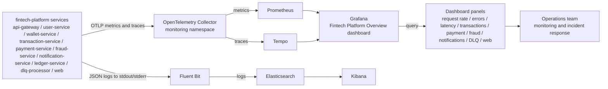

# Grafana dashboard runbook

This runbook documents how to implement the Fintech Platform Overview dashboard for the fintech platform stack and how to standardize it for production use.

The monitor flow is defined in the repository docs:

- [../README.md](../README.md)
- [OBSERVABILITY.md](OBSERVABILITY.md)
- [RUNBOOK.md](../RUNBOOK.md)
- [../../fintech-platform/docs/OBSERVABILITY.md](../../fintech-platform/docs/OBSERVABILITY.md)

The application repo owns service instrumentation. The GitOps repo owns the infrastructure, Prometheus, Grafana, and the dashboard deployment model.

---

## 1. End-to-end telemetry and dashboard flow



This diagram shows the full path from service instrumentation to Prometheus scraping, Grafana visualization, and operational use.

## 2. Objective

Create a concise Grafana dashboard showing the operational state of the fintech platform across all application services:

1. Service request rate
2. Service error rate
3. p95 latency by service
4. Transaction success/failure
5. Payment failure count
6. Fraud alerts
7. Notification delivery status
8. DLQ retry count
9. Redis/Kafka dependency health
10. Web page/API latency

The dashboard should help operators answer three questions quickly:

- Is the platform healthy?
- Are business flows succeeding?
- Are any services or dependencies failing?

---

## 2. Prerequisites

Before building the dashboard, verify the following:

- Prometheus is enabled in the target environment
- Grafana is reachable at the configured hostname
- the OpenTelemetry Collector is scraping and healthy
- application services are emitting metrics
- Prometheus has the expected service metrics available in its UI

### Check that targets are up

```promql
up
```

### Check that the metrics target exists

```promql
sum by (service_name) (rate(http_server_duration_count{service_namespace="fintech-platform"}[5m]))
```

If this returns no data, the services may not be emitting the expected metric or the metric name may differ from the default expectation.

---

## 3. Recommended dashboard layout

### Row 1: Service health

- Service request rate
- Service error rate
- p95 latency by service

### Row 2: Business flows

- Transaction success/failure
- Payment failure count
- Fraud alerts

### Row 3: Integration and recovery

- Notification delivery status
- DLQ retry count
- Redis/Kafka dependency health

### Row 4: Frontend and user experience

- Web page/API latency

---

## 4. Exact dashboard panels and PromQL

### Panel 1: Service request rate

```promql
sum by (service_name) (
  rate(http_server_duration_count{service_namespace="fintech-platform"}[5m])
)
```

Use: time series by service.

### Panel 2: Service error rate

```promql
sum by (service_name) (
  rate(http_server_duration_count{service_namespace="fintech-platform", http_status_code=~"5.."}[5m])
)
```

Use: time series for 5xx errors.

### Panel 3: p95 latency by service

```promql
histogram_quantile(
  0.95,
  sum by (service_name, le) (
    rate(http_server_duration_bucket{service_namespace="fintech-platform"}[5m])
  )
)
```

Use: time series in ms or seconds depending on the bucket unit.

### Panel 4: Transaction success/failure

```promql
sum by (service_name, result) (
  rate(transaction_attempts_total{service_namespace="fintech-platform"}[5m])
)
```

If the service emits `status` or `outcome` instead of `result`, use that label name.

### Panel 5: Payment failure count

```promql
sum by (service_name) (
  rate(payment_failures_total{service_namespace="fintech-platform"}[5m])
)
```

### Panel 6: Fraud alerts

```promql
sum by (service_name) (
  rate(fraud_alerts_total{service_namespace="fintech-platform"}[5m])
)
```

### Panel 7: Notification delivery status

```promql
sum by (service_name, status) (
  rate(notification_delivery_total{service_namespace="fintech-platform"}[5m])
)
```

If the metric uses `outcome` instead of `status`, adjust accordingly.

### Panel 8: DLQ retry count

```promql
sum by (service_name) (
  rate(dlq_retries_total{service_namespace="fintech-platform"}[5m])
)
```

### Panel 9: Redis / Kafka dependency health

Redis:

```promql
redis_up
```

Kafka:

```promql
kafka_brokers
```

If the dependency metrics are not yet exposed, create placeholders or disable the panel until implemented.

### Panel 10: Web page/API latency

```promql
histogram_quantile(
  0.95,
  sum by (le) (
    rate(web_http_request_duration_seconds_bucket[5m])
  )
)
```

Optional route-level version:

```promql
histogram_quantile(
  0.95,
  sum by (route, le) (
    rate(web_http_request_duration_seconds_bucket[5m])
  )
)
```

---

## 5. Implementation workflow

### Step A: Validate metrics in Prometheus

Use the Prometheus UI or a curl command.

```bash
curl -s "http://<prometheus-host>:9090/api/v1/query?query=up" | jq
```

Then validate a representative service query:

```bash
curl -s "http://<prometheus-host>:9090/api/v1/query?query=sum%20by%20(service_name)%20(rate(http_server_duration_count{service_namespace=%22fintech-platform%22}[5m]))" | jq
```

### Step B: Create the dashboard in Grafana

1. Open Grafana
2. Click Create > Dashboard
3. Add panels one by one
4. Set panel names exactly as listed above
5. Use time range `5m`, `15m`, `1h` depending on needs
6. Save the dashboard as `Fintech Platform Overview`

### Step C: Validate each panel

Check that each panel has a non-empty result and that the series align with the expected services.

### Step D: Standardize for production

Once the dashboard works, create a reusable version:

- add variables for environment and service
- define recording rules where possible
- store the dashboard config in Git
- provision it automatically with Grafana provisioning or Kubernetes config

---

## 6. Recommended recording rules

Use recording rules to simplify the dashboards and reduce repeated query logic.

```promql
service_http_requests_total:rate5m = sum by (service_name, service_namespace, deployment_environment_name) (
  rate(http_server_duration_count[5m])
)

service_http_errors_total:rate5m = sum by (service_name, service_namespace, deployment_environment_name) (
  rate(http_server_duration_count{http_status_code=~"5.."}[5m])
)

service_http_latency_p95 = histogram_quantile(
  0.95,
  sum by (service_name, le) (
    rate(http_server_duration_bucket[5m])
  )
)
```

Then use the simpler queries in Grafana:

```promql
service_http_requests_total:rate5m
service_http_errors_total:rate5m
service_http_latency_p95
```

---

## 7. Dashboard-as-code path

This is the preferred long-term model.

### Best practice

- store Grafana dashboards in Git
- provision them with Grafana provisioning or a Kubernetes ConfigMap
- version dashboard JSON with the platform repo
- keep names and labels consistent across services

### Good labels to enforce

- service_name
- service_namespace
- deployment_environment_name
- result
- status
- http_status_code

This reduces dashboard drift and makes alerting easier.

---

## 8. Operational checklist

Use this checklist before going live:

- [ ] Prometheus target is UP
- [ ] Collector is healthy
- [ ] metrics names are confirmed in Prometheus
- [ ] at least one representative request hit each service
- [ ] transaction panel has data
- [ ] payment panel has data
- [ ] fraud panel has data
- [ ] notification panel has data
- [ ] DLQ retries are visible if relevant
- [ ] web latency panel has data
- [ ] dashboard is saved in Grafana
- [ ] dashboard JSON/config is committed to Git

---

## 9. Risks and caveats

- The exact metric names may differ from the examples depending on the instrumentation library and semantic conventions in use.
- Not all services may emit dependency metrics immediately.
- Error rate and latency must be validated against real traffic before being treated as production truth.
- Database, Kafka, Redis, and other dependency metrics should only be included after they are actually exported and tested.

---

## 10. Final recommendation

For this repo, the best path is:

1. Build the dashboard manually first to confirm the live metric names.
2. Standardize the metric labels and naming rules.
3. Add recording rules and dashboard-as-code provisioning.
4. Keep the final dashboard concise and business-focused.

This gives you a clean overview dashboard without overcomplicating the monitoring stack.
