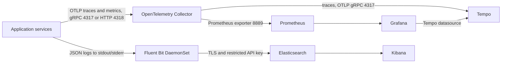

# Observability Contract

This repository deploys the observability infrastructure to existing EKS clusters. Application instrumentation belongs to the service repositories and is not verifiable here. The service list below comes from `Ecr-Repo/variable.tf`; it describes expected coverage, not proof that each service currently emits it.

## Implemented Data Paths



The Collector does not export application logs. Application logs use one path only: structured JSON to stdout/stderr, then Fluent Bit to Elasticsearch. Do not configure `OTEL_LOGS_EXPORTER=otlp` with this platform configuration. This avoids Collector debug-only log handling and duplicate ingestion.

The Collector's OTLP endpoints and Prometheus exporter are cluster-internal. The Prometheus configuration scrapes the Collector at `opentelemetry-collector.monitoring.svc:8889` every 30 seconds. Services send metrics through OTLP; they do not need a separate Prometheus scrape port. The Collector sends traces to Tempo at `tempo.monitoring.svc.cluster.local:4317`.

## Runtime Configuration

Set these values per service and environment:

```env
OTEL_SERVICE_NAME=payment-service
OTEL_SERVICE_VERSION=<release-version>
OTEL_RESOURCE_ATTRIBUTES=service.namespace=fintech-platform,deployment.environment.name=<dev|staging|production>,service.instance.id=<pod-name>
OTEL_EXPORTER_OTLP_ENDPOINT=http://opentelemetry-collector.monitoring.svc.cluster.local:4318
OTEL_EXPORTER_OTLP_PROTOCOL=http/protobuf
OTEL_TRACES_EXPORTER=otlp
OTEL_METRICS_EXPORTER=otlp
OTEL_LOGS_EXPORTER=none
```

The HTTP endpoint is for in-cluster workloads. Do not point a browser at this cluster-internal DNS name: browser telemetry needs a separately designed, externally reachable, authenticated and rate-limited OTLP/HTTP path or a trusted backend proxy. This repository does not expose such a route. Do not expose the Collector publicly as a quick fix.

Use standard HTTP server/client, database, cache, messaging, and external-provider instrumentation where those dependencies exist. Add business counters and histograms only for well-defined service outcomes. Keep metric labels bounded: never use user IDs, account numbers, transaction IDs, request IDs, or other unbounded identifiers as labels.

| Service | Expected traces | Expected metrics | Expected logs |
| --- | --- | --- | --- |
| `api-gateway` | inbound requests, downstream calls, auth flow | request volume, duration, status class, auth outcomes | access and routing events |
| `user-service` | auth/profile operations and database calls | auth outcomes, profile operations, dependency duration | user lifecycle events without credentials or raw PII |
| `wallet-service` | wallet and database operations | operation counts, duration, failures | wallet lifecycle events without balances or account secrets |
| `transaction-service` | database and message producer/consumer flow | transaction outcomes, duration, retries | transaction state transitions with safe references |
| `payment-service` | payment database and bank-provider calls | payment outcomes, validation results, duration | transfer outcomes with sensitive fields redacted |
| `fraud-service` | message consumption and risk evaluation | checks, decisions, processing duration | decisions without unnecessary personal or payment data |
| `notification-service` | message processing and provider calls | delivery outcomes, retries, duration | dispatch status without message bodies or credentials |
| `ledger-service` | ledger writes and related service calls | posting outcomes, duration, reconciliation failures | posting and reconciliation events |
| `dlq-processor` | consume/retry processing | backlog, retries, processing outcomes | recovery and dead-letter events |
| `mock-service` | mock provider requests | request counts, status, duration | mock interactions without secrets |
| `web` | browser page/API spans only after a supported browser export path exists | page and API timings only after that path exists | browser errors via the app's approved collection path |

The exact metric names depend on the instrumentation SDK and semantic-convention version. Agree on those names before writing dashboards or alert expressions; the platform repository does not define or verify application metric names.

## Logs and Data Hygiene

Emit one JSON object per log event to stdout/stderr. Include an event timestamp, severity, message, `service.name`, `service.version`, `deployment.environment.name`, `service.instance.id`, and `trace_id`/`span_id` when an active span exists. Include request and HTTP outcome fields where relevant. Fluent Bit enriches container records with Kubernetes metadata and forwards them over TLS to Elasticsearch. Do not write secrets to logs.

Never log passwords, tokens, authorization headers, full PAN data, provider secrets, message bodies containing sensitive data, or unnecessary personal data. Use bounded operational references and apply the application's retention and privacy requirements.

## Platform Settings and Limits

| Component | Current configuration | Important limit |
| --- | --- | --- |
| Prometheus | 15-day retention, 20Gi PVC | only Collector-exported application metrics plus chart-managed targets are scraped |
| Grafana | enabled, 10Gi PVC, Prometheus and Tempo datasources | password is supplied through Terraform; Terraform state must remain protected |
| OpenTelemetry Collector | 2 replicas, OTLP 4317/4318, Prometheus exporter 8889 | internal ClusterIP; 500m CPU and 512Mi memory limit per replica |
| Tempo | local trace backend, 24-hour retention, 20Gi PVC | single-binary/local storage baseline; no object-store replication or snapshot automation |
| EFK | Fluent Bit, Elasticsearch, Kibana; 14-day log ILM | enabled in dev; snapshots/restore are not configured here |

The Tempo PVC protects data from ordinary pod replacement, but it is not a backup or a highly available trace store. Use an approved object-storage and recovery design before treating Tempo as production-durable. The Helm chart's default Kubernetes dashboards and rules do not provide application-specific dashboards or notification destinations. Configure and test alert receivers before relying on notifications.

Monitoring and EFK are independent opt-in add-ons in each Terraform root. Confirm the target root's `enable_monitoring` and `enable_efk` values before planning. EFK state, credentials, data, and capacity are isolated per cluster.

## Verification

Operational rollout, validation commands, access controls, and troubleshooting are in the [monitoring and observability runbook](../RUNBOOK.md#monitoring-and-observability-operations) and [EFK logging runbook](../RUNBOOK.md#efk-logging-operations). Terraform success proves only that Helm releases were applied; it does not prove application instrumentation, trace delivery, metric names, log quality, alert routing, or browser telemetry.
