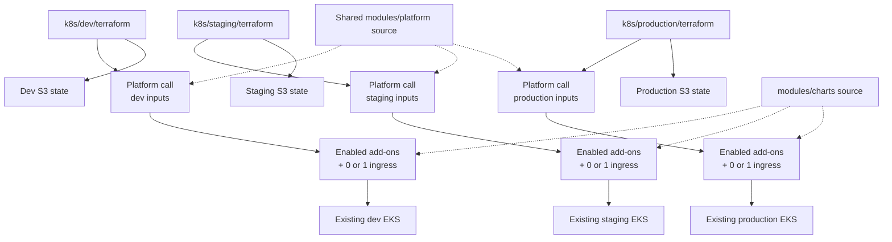
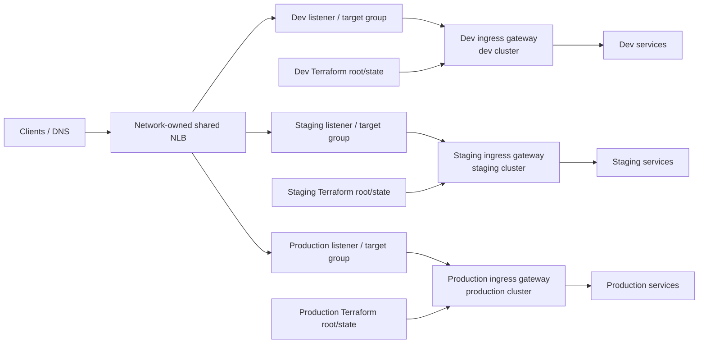

# Kubernetes platform

This directory configures add-ons and ingress on existing EKS clusters. It
does not create clusters, VPCs, or worker nodes.

## Architecture

Each root passes environment-specific values to `modules/platform`. That
composition module enables add-ons and at most one selected ingress. Focused
modules under `modules/addons/` and the ingress modules implement those
capabilities. Shared Helm charts live under `modules/charts/`.

Modules are code reuse, not state boundaries. Every resource created by a
child module is stored in the state of the environment root that called it.
Keep each cluster resource under one Terraform owner.

## Environment profiles

| Environment | Ingress default | Argo CD | EFK |
| --- | --- | --- | --- |
| Dev | `f5-nginx` | Disabled by default; dev application deployments use the manual release workflow | Enabled for initial validation |
| Staging | `alb` | Enabled | Disabled |
| Production | `envoy` | Enabled | Disabled |

The ingress input accepts `none`, `envoy`, `nginx`, `f5-nginx`, or `alb`.
Add-on flags (KEDA, cert-manager, Route 53 DNS-01, monitoring, frontend, and
Argo CD) are configured separately in each root's local tfvars or through
`TF_VAR_*`. The defaults differ by environment; see its README and
`variables.tf`.

## Monitoring and OpenTelemetry

When `enable_monitoring = true`, the shared add-on installs kube-prometheus-
stack, Tempo, and the OpenTelemetry Collector in namespace `monitoring`.
Workloads send OTLP traces and metrics to the Collector's internal ClusterIP
on gRPC `4317` or HTTP/protobuf `4318`. The Collector exports traces to Tempo
and exposes metrics on `8889`, which Prometheus scrapes every 30 seconds.
Grafana has Prometheus and Tempo datasources. The Collector is not exposed by
an ingress, and application logs are not exported through OTLP.

Tempo currently uses local storage with a 24-hour retention period and a 20Gi
PVC. This persists through a pod replacement but is not a backup or an HA
design. Prometheus uses 15-day retention and a 20Gi PVC; Grafana uses a 10Gi
PVC. The kube-prometheus-stack supplies its chart defaults, but this repo does
not define application-specific dashboards, alert rules, or notification
receivers. Protect `grafana_admin_password` and Terraform state; provide the
password through a protected `TF_VAR_grafana_admin_password` source.

Do not configure `OTEL_LOGS_EXPORTER=otlp`: there is no Collector logs export
pipeline. Emit structured JSON logs to stdout/stderr for Fluent Bit, and keep
the Collector endpoint private. Browser telemetry needs a separately designed
authenticated OTLP/HTTP path or backend proxy; no public browser endpoint is
configured here. See the [observability contract](../docs/OBSERVABILITY.md)
and [monitoring operations runbook](../RUNBOOK.md#monitoring-and-observability-operations)
for the service contract, rollout, validation, and troubleshooting steps.

## EFK logging

Each environment can run its own isolated logging stack in the `logging`
namespace. The shared `modules/addons/logging` module installs Elastic's
ECK operator, an Elasticsearch and Kibana custom resource from the local
`modules/charts/efk` chart, and Fluent Bit as a DaemonSet. Fluent Bit tails
container logs, adds Kubernetes metadata, and sends them to that environment's
Elasticsearch over TLS. Log data and credentials are not shared across
clusters. This is the only supported application log path: JSON on stdout or
stderr to Fluent Bit to Elasticsearch. It is separate from the OTLP traces and
metrics path through the Collector.

The initial rollout enables EFK only in dev. Staging and production have
complete capacity inputs but remain disabled until dev is validated and each
environment is approved separately. The configured Elasticsearch capacity is
1 node with 20Gi per node in dev, 3 nodes with 50Gi each in staging, and 3
nodes with 100Gi each in production. Every Elasticsearch node requests and is
limited to 2 CPU and 4Gi memory; Kibana requests and is limited to 500m CPU
and 1Gi memory. Fluent Bit additionally uses 100m/128Mi requests and
500m/512Mi limits per cluster node. These are substantial cluster capacity
requirements, especially for production.

The `elasticsearch_storage_class` input is empty by default, so Kubernetes
uses the cluster's default StorageClass. Retention is set to 14 days through
an Elasticsearch ILM policy applied to Fluent Bit's `logs-*` indices. This is
not a backup: no snapshot repository or snapshot schedule is configured.
Before enabling staging or production, provision and test snapshots to durable
storage, verify restore procedures, and approve storage, retention, access,
and cost expectations.

Kibana is routed at `kibana.<ingress_domain_suffix>` through the selected
environment ingress. Set `kibana_hostname` explicitly if using another name
under that suffix. Create the DNS record separately. With DNS-01 enabled,
cert-manager requests TLS for the hostname; for ALB, configure an ACM
certificate covering it. The ingress terminates public TLS; Kibana's
in-cluster HTTP endpoint is not encrypted, so use trusted cluster networking
and do not expose the endpoint outside the intended ingress. Kibana requires
the Elasticsearch `elastic` account; retrieve its generated password from the
cluster's `elasticsearch-es-elastic-user` secret and do not put it in tfvars.

The EFK values are passed from each environment root through
`modules/platform` into the logging add-on. Use the root-specific tfvars:
`enable_efk = true` in dev, and keep it `false` in staging and production
until rollout approval. Review the Terraform plan carefully; enabling EFK
creates persistent volumes and disabling it removes Helm-managed workloads.
See the [EFK rollout and operating steps](../RUNBOOK.md#efk-logging-operations).

## Derived dependencies and behavior

`modules/platform/locals.tf` derives these dependencies:

- The AWS Load Balancer Controller is installed if explicitly enabled, if
  Argo CD is enabled, or if an ingress other than `none` is selected.
- The EKS Pod Identity Agent is installed if explicitly enabled, if the AWS
  Load Balancer Controller is needed, or if Route 53 DNS-01 is enabled.

These are dependencies of the current integrations. ALB routes use the AWS
Load Balancer Controller; the current Envoy, NGINX, and F5 NGINX modules also
request AWS-managed NLBs through Kubernetes Services. They do not attach to
an externally managed shared NLB.

ALB ingress uses an ACM certificate. DNS-01 TLS for NLB-backed ingress
requires cert-manager, Route 53 configuration, and an operations email.
Application DNS records are managed separately from ACME validation records.
Review plans carefully when disabling an add-on or changing ingress: with
`count`, disabling a module removes its resources from that environment's
configuration.

## Using a network-owned shared NLB

**This is not supported by the current Terraform configuration.** There is no
setting that both turns off the AWS Load Balancer Controller and keeps the
current ingress modules functional:

- Setting `enable_aws_load_balancer_controller = false` does not disable it
  while `ingress_controller != "none"` or `enable_argocd = true`; the
  dependency is derived in `modules/platform/locals.tf`.
- Setting `ingress_controller = "none"` removes the platform-managed
  application ingress. It does not attach that ingress to an existing NLB.
- Envoy, ingress-nginx, and F5 NGINX currently request a new NLB using a
  Kubernetes `LoadBalancer` Service. The `alb` option creates ALB Ingress
  resources reconciled by the AWS Load Balancer Controller.
- Staging and production Argo CD also currently expose their server through
  an AWS-LBC-managed ALB. Disabling the controller requires redesigning that
  endpoint too, or disabling Argo CD.

### Intended cross-environment scenario

The shared NLB belongs to the network/shared-infrastructure owner. Each
environment remains isolated: its Terraform root and state manage its own
cluster add-ons, ingress gateway, Kubernetes Services, and application routes.
The shared network layer manages the NLB listeners and a distinct target group
for each environment. Traffic reaches the environment's ingress gateway, and
that gateway routes to services in only its own cluster.

The diagram shows the desired ownership and traffic separation, not a feature
already implemented here. A single NLB does not route on HTTP hostnames like
an ALB. The network team and platform owners must choose how traffic selects
an environment (for example, separate listener ports, or a separately
designed shared Layer 7 proxy), and define TLS termination/SNI, target type,
health checks, security rules, DNS, and target registration/removal. Do not
assume DNS hostnames alone select separate NLB target groups.

### Changes required before using this design

Implement and test the integration before changing environment flags:

1. Agree with the network owner on the shared NLB contract: environment
   selection mechanism (listener ports or Layer 7 routing), target groups,
   target type, health checks, TLS/certificate termination, security rules,
   DNS, and ownership of target registration as nodes or pods change.
2. Replace each selected ingress's AWS-created `LoadBalancer` Service with
   an integration to its environment's shared-NLB target group. The target
   registration method must not depend on the AWS Load Balancer Controller
   if that controller is to be removed. `TargetGroupBinding` does not meet
   that requirement because AWS Load Balancer Controller reconciles it.
3. Replace ALB Ingress resources where needed. In particular, staging uses
   ALB for application ingress and staging/production Argo CD currently use
   ALB. Each must use the shared-NLB path or be disabled before AWS Load
   Balancer Controller can be removed from that environment.
4. Change `modules/platform/locals.tf` so the AWS Load Balancer Controller is
   required only by remaining integrations that actually use it. Keep it
   enabled in any environment that still has AWS-LBC-managed resources.
5. Test each environment and review its own Terraform state and plan. Confirm
   the network stack remains the only owner of the shared NLB and that plans
   preserve ingress gateways, healthy targets, Argo CD (if retained), and
   application endpoints.

Only after that implementation exists should an environment use a
non-`none` ingress with `enable_aws_load_balancer_controller = false`. Until
then, that setting does not avoid installation; setting `ingress_controller =
"none"` avoids the current ingress path but leaves no Terraform-managed
application ingress. The environment READMEs describe each environment's
part in this proposed design.

## State and generated files

All three platform roots use separate S3 state keys configured through each
root's ignored `backend.hcl`: `dev/terraform.tfstate`,
`staging/terraform.tfstate`, and `production/terraform.tfstate`. Never
initialize an environment with another environment's backend key. When
migrating existing dev local state, back it up and use the procedure in the
[runbook](../RUNBOOK.md#moving-existing-state-to-s3). Terraform's
`.terraform/` directory, including `modules/modules.json`, is local generated
cache metadata; it is not state or source configuration.

The dev tree also contains `dev/terraform/ingress-dns01/`, a separate
standalone ingress-nginx/cert-manager Terraform root. It has its own local
state and is an alternative to the standard dev platform ingress, not an
additional module in `modules/platform`. Do not run both roots against the
same ingress, cert-manager, or Pod Identity resources.

For initialization, plans, applications, and the one-time dev state address
migration, see [`../RUNBOOK.md`](../RUNBOOK.md).
