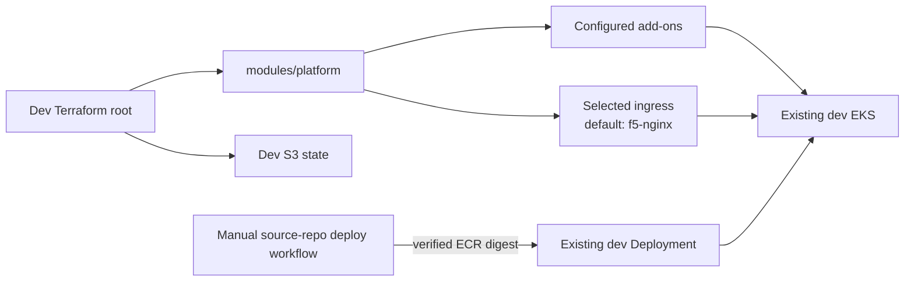

# Dev EKS platform

The dev Terraform root configures add-ons and ingress on the existing dev EKS
cluster. It does not create the cluster, VPC, worker nodes, or application
Deployments.

## Current integration



Terraform owns the platform add-ons and ingress. The manually dispatched
release workflow in [`qzee-dev/fintech-platform`](https://github.com/qzee-dev/fintech-platform)
updates an existing `Deployment` in namespace `dev` to a verified ECR image
digest. It does not create that Deployment. Dev does not use Argo CD for
application releases.

## Inputs and operations

Set the actual `cluster_name`, `vpc_id`, and finance-approved `cost_center`
in the dev tfvars or through `TF_VAR_*`. The checked-in dev tfvars is tracked:
do not add secrets to it. Provide any required ingress hostname, certificate,
DNS, or secret values for the options you enable. The cluster must be active
and reachable from the Terraform runner.

Replace every `REPLACE_WITH_...` value in the tracked dev tfvars before
planning. In particular, set `ingress_domain_suffix` and the full
`grafana_hostname` and `prometheus_hostname` beneath it (for example, if the
suffix is `dev.example.com`, use `grafana.dev.example.com` and
`prometheus.dev.example.com`). The frontend route uses
`app.<ingress_domain_suffix>`.

The local routes chart uses these hostnames to create Kubernetes routes to
Grafana and Prometheus; it does not create DNS records. Create DNS records for
the frontend and monitoring hostnames pointing to the F5 NGINX load balancer.
The configured `internal` load balancer is reachable only from networks that
can access it. Route 53 DNS-01 is for ACME certificate validation, not for
creating these application records. Keep the Grafana admin password out of
the tracked tfvars and supply it through a protected secret as
`TF_VAR_grafana_admin_password` (at least 16 characters).

Configure `backend.hcl` from `backend.hcl.example` with the approved state
bucket and preserve the `dev/terraform.tfstate` key. For an existing local
state, securely back it up and migrate it to this S3 key; see the
[runbook](../../RUNBOOK.md#moving-existing-state-to-s3).

From `k8s/dev/terraform/`:

```sh
cp backend.hcl.example backend.hcl
# Set the approved bucket in backend.hcl before initialization.
terraform init -backend-config=backend.hcl
terraform fmt -check
terraform validate
terraform plan
terraform apply
```

Review the plan before applying, especially when disabling an add-on or
changing `ingress_controller`. The KEDA release has `prevent_destroy` because
its CRDs may contain application resources.

### EFK logging rollout

Dev is the only environment with `enable_efk = true` in its tfvars. Before
applying, replace `REPLACE_WITH_DEV_KIBANA_HOSTNAME` with a hostname beneath
`ingress_domain_suffix` (normally `kibana.<ingress_domain_suffix>`), ensure
the DNS record points to the F5 NGINX load balancer, and confirm the worker
nodes have capacity for one Elasticsearch node (2 CPU, 4Gi memory, 20Gi
persistent storage), Kibana (500m CPU, 1Gi memory), and one Fluent Bit pod per
node. If DNS-01 TLS is enabled, verify Route 53 and cert-manager are ready.

The stack retains logs for 14 days. The local EFK chart configures ILM and a
restricted Fluent Bit API key; it does not configure Elasticsearch snapshots.
Dev is a validation environment, not a backup source. See the
[EFK operations](../../RUNBOOK.md#efk-logging-operations) before planning or
applying.

## Existing shared NLB

**Current status:** the default F5 NGINX module requests its own NLB. It does
not use the network-owned shared NLB, and setting
`enable_aws_load_balancer_controller = false` will not change that.

**Intended shared-NLB role:** the network owner supplies a dev-specific
listener/target group on the shared NLB. The dev root would continue to own
the dev F5 NGINX gateway and routes in the dev cluster, changed to receive
traffic from that target group without creating an AWS load balancer. Dev
application releases continue through the existing manual digest deployment
workflow. Argo CD is off by default, so there is no Argo CD endpoint to
redesign unless it is explicitly enabled.

This requires implementing the shared target integration and changing the
platform's derived controller dependency before turning the controller off.
See the [shared-NLB design and requirements](../README.md#using-a-network-owned-shared-nlb).

## Existing state migration

If the existing dev state has the previous root-level resource addresses,
perform the one-time `terraform state mv` operations documented in the
[runbook](../../RUNBOOK.md) before planning. Do not run moves for resources
that are absent or already at the destination. Back up the state first.

The optional `terraform/ingress-dns01/` directory is a separate standalone
Terraform root and state, not part of this platform composition. Use it only
instead of the main dev ingress path; do not let both roots manage the same
ingress, cert-manager, or Pod Identity resources.
