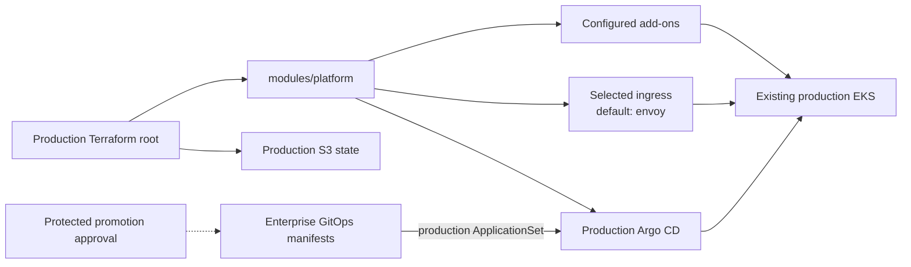

# Production EKS platform

The production Terraform root configures the existing production EKS cluster.
It uses the shared `modules/platform` composition with production-specific
inputs and its own S3 state key, `production/terraform.tfstate`.

## Current integration



Production Argo CD syncs the production ApplicationSet from
[`qzee-dev/fintech-enterprise-gitops-manifest`](https://github.com/qzee-dev/fintech-enterprise-gitops-manifest).
Promotion updates production values there after the required approval. This
root uses neither staging's Terraform state nor staging's cluster.

## Inputs and operations

Configure `backend.hcl` from `backend.hcl.example` with the approved state
bucket. Set production-only cluster, VPC, cost center, domains, certificates,
and secrets using the production tfvars example or `TF_VAR_*`. Do not reuse
the staging backend key or values.

From `k8s/production/terraform/`:

```sh
cp backend.hcl.example backend.hcl
# Set the bucket in backend.hcl and configure environment inputs.
terraform init -backend-config=backend.hcl
terraform fmt -check
terraform validate
terraform plan
terraform apply
```

The default ingress is `envoy`; select one supported ingress and configure
its required certificate and DNS values. Review and approve the plan before
applying. Keep production credentials and Grafana secrets in a protected
secret source. See the [runbook](../../RUNBOOK.md) for backend migration and
promotion procedures.

## Existing shared NLB

**Current status:** the default Envoy module requests its own NLB through a
Kubernetes `LoadBalancer` Service. Production Argo CD also uses an
AWS-LBC-managed ALB. Neither currently uses a network-owned shared NLB.

**Intended shared-NLB role:** the network owner supplies a
production-specific listener/target group. Production's root would continue
to own the production Envoy gateway and routes, changed to receive traffic
from that target group without creating an AWS load balancer. Production Argo
CD must also move to this path or be disabled; otherwise AWS Load Balancer
Controller remains required.

This needs an implemented target integration and Argo CD endpoint redesign,
plus an update to platform dependency logic, before the controller can be
turned off. See the
[shared-NLB design and requirements](../README.md#using-a-network-owned-shared-nlb).
