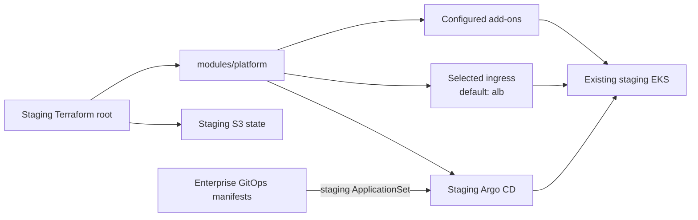

# Staging EKS platform

The staging Terraform root configures the existing staging EKS cluster. It
uses the shared `modules/platform` composition with staging-specific inputs
and its own S3 state key, `staging/terraform.tfstate`.

## Current integration



Staging Argo CD syncs the staging ApplicationSet from
[`qzee-dev/fintech-enterprise-gitops-manifest`](https://github.com/qzee-dev/fintech-enterprise-gitops-manifest).
Promotion updates the staging values there; it does not share Terraform state
with production.

## Inputs and operations

Configure `backend.hcl` from `backend.hcl.example` with the approved state
bucket. Set the staging cluster, VPC, cost center, domains, certificates, and
secrets using the staging tfvars example or `TF_VAR_*`. Do not reuse the
production backend key or values.

From `k8s/staging/terraform/`:

```sh
cp backend.hcl.example backend.hcl
# Set the bucket in backend.hcl and configure environment inputs.
terraform init -backend-config=backend.hcl
terraform fmt -check
terraform validate
terraform plan
terraform apply
```

The default ingress is `alb`; select one supported ingress and configure its
required certificate and DNS values. Review the plan before applying, and do
not let this root replace add-ons already owned by another stack. See the
[runbook](../../RUNBOOK.md) for backend migration and deployment flow.

## Existing shared NLB

**Current status:** the default ALB option creates AWS-LBC-managed ALB
Ingress resources. It does not use a network-owned shared NLB, and the staging
Argo CD endpoint also uses an AWS-LBC-managed ALB.

**Intended shared-NLB role:** the network owner supplies a staging-specific
listener/target group. Staging's root would own a staging ingress gateway and
routes in the staging cluster, connected to that target group without
creating an AWS load balancer. Staging Argo CD must also move to this path or
be disabled; otherwise AWS Load Balancer Controller remains required.

This needs an implemented ingress and Argo CD endpoint redesign, and a
corresponding update to the platform's controller dependency, before the
controller can be turned off. See the
[shared-NLB design and requirements](../README.md#using-a-network-owned-shared-nlb).
